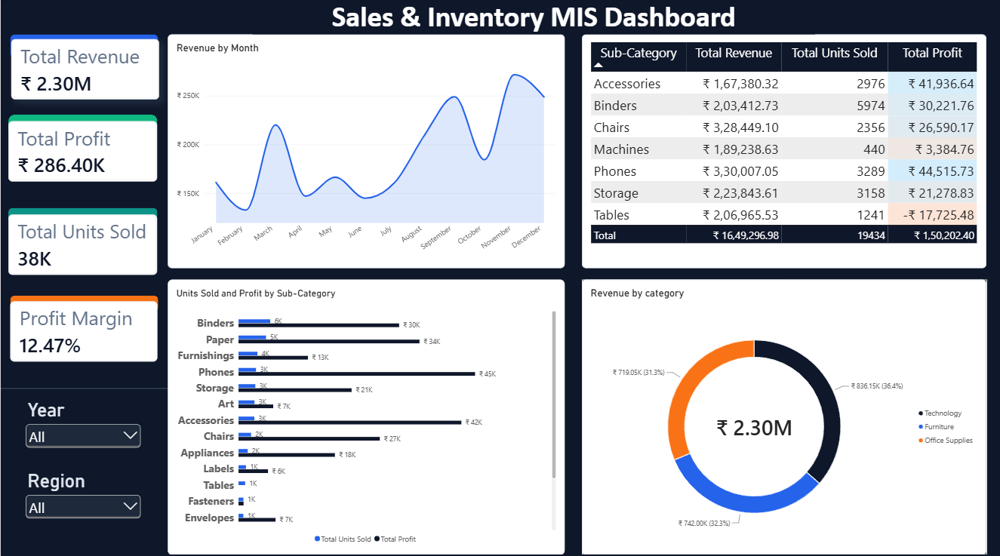

# Sales & Inventory MIS Dashboard (PostgreSQL + Power BI)

An end-to-end Management Information System (MIS) dashboard built to track retail revenue, profit margins, seasonality, and inventory movement across product categories and regions.

## Dashboard Preview

## Executive Summary & Key Metrics
* **Total Revenue:** ₹ 2.30M
* **Total Profit:** ₹ 286.40K
* **Total Units Sold:** 38K
* **Overall Profit Margin:** 12.47%

## Key Business Insights
* **Category Revenue Split:** **Technology** leads revenue generation at **₹ 836.15K (36.4%)**, followed closely by **Furniture** at **₹ 742.00K (32.3%)** and **Office Supplies** at **₹ 719.05K (31.3%)**.
* **Inventory Volume vs. Profitability:** **Binders** recorded the highest unit movement (~6K units) with strong profitability (₹ 30.2K), whereas **Phones** and **Accessories** drove the highest profit margins despite lower unit volume.
* **Margin Leakage Alert:** **Tables** generated over ₹ 2.06L in revenue across 1,241 units sold but resulted in a net loss of **-₹ 17,725.48**, highlighting aggressive discounting and high fulfillment costs that require pricing review.
* **Seasonality Trends:** Revenue shows strong Q4 momentum, peaking in **November** (~₹ 270K+) following an earlier mid-year surge in **September**.

## Tech Stack & Architecture
1. **Database & Data Modeling (PostgreSQL):**
   * Designed a relational schema (`superstore_sales`) and ingested ~10,000 retail order records.
   * Wrote analytical SQL queries utilizing **CTEs**, **Window Functions (`LAG`)** for Month-over-Month (MoM) growth, and `HAVING` clauses to isolate loss-making sub-categories.
2. **Business Intelligence & Visualization (Microsoft Power BI):**
   * Connected Power BI Desktop directly to the local PostgreSQL instance.
   * Created custom **DAX measures** (`Total Revenue`, `Total Profit`, `Total Units Sold`, `Profit Margin %`) with dynamic formatting and conditional color alerts for negative profitability.
   * Designed a SaaS-inspired executive layout with interactive **Year** and **Region** slicers.

## Repository Structure
* `sales_inventory_queries.sql` — PostgreSQL DDL schema and 6 business intelligence queries (KPI validation, regional breakdown, top products, inventory velocity, MoM growth, and discount loss analysis).
* `Sales_Inventory_Dashboard.pbix` — Interactive Power BI Desktop report file.
* `dashboard_preview.png` — High-resolution preview of the completed MIS dashboard.
